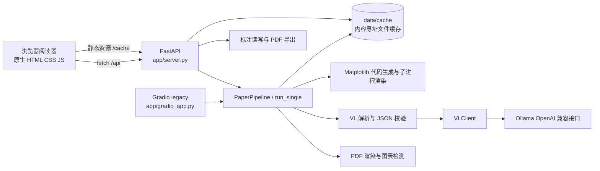

# Code Wiki：论文阅读器与图表复刻系统

> 本文以当前源码和测试为准，说明仓库结构、模块职责、主要调用关系、运行配置与验证方式。设计文档用于解释设计意图；如与实现不一致，应以源码和测试结果为准。

## 1. 项目概览

这是一个面向论文 PDF 阅读和图表数据复刻的本地应用。用户可以导入论文、浏览页面、添加并导出标注、检测图表区域，并按需解析折线图、柱状图、柱线组合图或热力图。视觉模型通过 OpenAI 兼容接口连接 Ollama；默认端点为本机，PDF/图片不会被应用主动上传到公网。若将 `CHART_SDK_BASE_URL` 配置为远程端点，图像请求会发送至该端点。

当前主入口是 **FastAPI + 原生 JavaScript 阅读器**；`app/gradio_app.py` 是保留的旧版全量解析界面（legacy）。`chart_sdk` 承担模型调用、PDF 处理、图表数据校验、Matplotlib 代码生成、缓存和标注导出。

## 2. 快速导航

| 想了解 | 入口 |
|---|---|
| 项目用途、用户操作、环境变量 | [README.md](README.md) |
| 运行状态与已知限制 | [STATUS.md](STATUS.md) |
| 开发阶段计划 | [PLAN.md](PLAN.md) |
| 当前阅读器设计 | [阅读器设计文档](docs/superpowers/specs/2026-10-19-paper-reader-design.md) |
| 初版图表复刻设计 | [图表复刻设计文档](docs/superpowers/specs/2026-10-19-paper-chart-replication-design.md) |
| 后端 HTTP API | [app/server.py](app/server.py) |
| 端到端业务编排 | [chart_sdk/pipeline/paper.py](chart_sdk/pipeline/paper.py) |
| Python 依赖 | [requirements.txt](requirements.txt) |
| 离线自检 | [scripts/selfcheck.py](scripts/selfcheck.py) |

## 3. 总体架构



### 3.1 分层与依赖方向

1. **表示层**：`app/reader/` 是无构建步骤的 ES module 前端；`app/gradio_app.py` 保留旧 UI。
2. **应用/API 层**：`app/server.py` 负责 HTTP 路由、上传、后台检测线程、缓存静态文件托管及异常到 HTTP 状态码的转换。
3. **应用编排层**：`chart_sdk/pipeline/` 串联 PDF、视觉解析、代码生成、执行和缓存。
4. **领域能力层**：`pdf/`、`vision/`、`codegen/`、`inference/`、`annotate/` 各自封装单一能力。
5. **持久化层**：`chart_sdk/cache/store.py` 和 `data/cache/` 保存原 PDF、页面图、会话、图表产物、单图产物与导出文件。

核心依赖流为 `server -> pipeline -> (pdf, vision, codegen, inference, cache)`；标注 API 直接使用 `annotate` 和 `PaperStore`。模块之间通过字典形式的 chart/session 结构传递数据，图表 JSON 的校验边界位于 `vision.validator`。

## 4. 仓库目录

| 路径 | 内容 | 运行时性质 |
|---|---|---|
| `app/server.py` | FastAPI 服务、阅读器 API 和静态文件挂载 | 主服务入口 |
| `app/reader/` | HTML/CSS 与原生 JavaScript 阅读器 UI | 浏览器静态资源 |
| `app/gradio_app.py` | 初版 Gradio 论文/单图 UI | legacy 入口 |
| `chart_sdk/` | 可复用的图表识别与论文处理 SDK | 业务核心 |
| `scripts/` | 样例论文生成/下载、自检和截图辅助脚本 | 开发/验证工具 |
| `tests/unit/` | 不依赖真实视觉模型的模块测试 | pytest 单元测试 |
| `tests/integration/` | API 流程与真实 VL 调用集成测试 | API 可离线 mock；VL 测试需 Ollama |
| `assets/samples/` | 样例论文资产 | 自检脚本依赖合成样例 PDF |
| `data/cache/` | 按内容哈希组织的运行产物 | 自动生成，可删除以清除缓存 |
| `docs/superpowers/` | 设计文档与实施计划 | 项目设计资料 |
| `work/` | 本地工作目录 | 非运行模块 |

## 5. 核心业务流程

### 5.1 阅读器论文流程

1. 前端 `viewer.importFile()` 将 PDF 和 `detect` 开关发送至 `POST /api/papers`。
2. `PaperStore` 对 PDF 字节计算 SHA-256，并创建/复用 `data/cache/papers/<hash>/` 会话目录。
3. `PaperPipeline.render_only()` 同步渲染最多 `CHART_SDK_MAX_PAGES` 页，用户可以尽快开始阅读。
4. 若启用检测，服务通过后台线程调用 `PaperPipeline.detect()`：逐页先用 `VLGroundingDetector` 整页定位；空结果时对重叠分区补扫；仍为空或抛异常时回退到嵌入位图/大型矢量绘图候选，再由 VL 分类过滤。
5. 前端 `figures.js` 轮询状态并显示图框。用户点击某图后请求 `parse_figure()`；成功结果写入缓存，重复点击直接读缓存，不重复推理。
6. `vision.parser.parse_chart()` 提取结构化图表数据，`validator.validate_chart()` 清理和校验；`generator.generate_code()` 生成 Matplotlib 脚本，`executor.execute_code()` 在临时目录子进程内执行并产出复刻 PNG。

### 5.2 单图工具箱流程

右栏工具箱调用 `POST /api/singles/parse`，后端 `run_single()` 使用 `SingleStore` 进行内容寻址缓存，再复用同一套解析、校验、代码生成和渲染能力。返回原图、数据、代码和渲染图的缓存 URL/内容。

### 5.3 标注流程

前端以页面归一化坐标保存墨迹和文本批注；`annotate.js` 在最后一次变更 1 秒后调用 `PUT /annotations`。服务端 `AnnotationStore` 校验数据后原子写入 `annotations.json`。导出时 `export_annotated()` 生成新的 PDF 副本：墨迹作为透明图像层，文本批注作为 PDF text annotation；原始 PDF 不变。

## 6. 关键模块与符号

### 6.1 应用入口和 HTTP 服务

**[app/server.py](app/server.py)**

| 符号 | 职责 |
|---|---|
| `config` / `client` / `pipeline` | 模块级配置、VL 客户端和论文流水线实例 |
| `_open_store(hash)` | 按哈希打开论文会话；缺失时转为 HTTP 404 |
| `_start_detect(hash)` / `_run_detect(hash)` | 以线程启动检测、避免同一哈希重复并发检测，并维护运行态进度 |
| `upload_paper()` | 收 PDF、同步渲染页面、记录文件名；可选异步检测 |
| `start_detect()` / `paper_status()` | 重新检测与查询会话/检测状态 |
| `page_png()` / `list_figures()` | 提供页面 PNG 和图框列表 |
| `parse_one()` | 按需解析指定图表 |
| `get_annotations()` / `put_annotations()` | 标注侧车读写 |
| `export_paper()` | 生成并下载带标注 PDF 副本 |
| `parse_single()` | 接收单图并运行单图解析链路 |
| `health()` | 返回 Ollama 可达性、模型可用性和模型名 |

`/cache` 挂载缓存目录，`/` 挂载阅读器静态目录。Windows 下显式注册 `.js` 和 `.css` MIME 类型，以避免 ES module 被浏览器按错误类型拒绝。

### 6.2 配置与推理

**[chart_sdk/config.py](chart_sdk/config.py)**：`Config` dataclass 保存 endpoint、模型名、DPI、页数上限、超时、缓存目录、重试次数和 API 端口；`Config.from_env()` 读取环境变量。

**[chart_sdk/inference/client.py](chart_sdk/inference/client.py)**：`VLClient` 包装 `openai.OpenAI`，对接 Ollama 的 OpenAI 兼容 API。`health()` 探活，`model_available()` 检查模型列表，`chat_image()` 将提示词和 base64 图像发送给模型，并按配置重试。

### 6.3 PDF 渲染、检测与几何

**[chart_sdk/pdf/render.py](chart_sdk/pdf/render.py)**

- `render_pages(pdf_path, out_dir, dpi, max_pages)`：用 PyMuPDF 逐页生成 PNG，并返回页码、相对路径和像素尺寸。
- `crop_page_region(page_png, bbox_px, out_path)`：钳制 bbox 后裁出图表区域。

**[chart_sdk/pdf/detector.py](chart_sdk/pdf/detector.py)**

- `FigureBBox`：检测结果数据类，含 `id/page/bbox_norm/bbox_px/type/source/caption_hint`；类型包括 line/bar/combo/heatmap。
- `FigureDetector.detect_page()`：检测器接口。
- `VLGroundingDetector.detect_page()`：整页 VL grounding；去重后不足两张时扫描 70% 重叠分区，并把局部 bbox 映射回页面后去重。
- `BitmapFallbackDetector.detect_page()`：提取 PDF 嵌入图片，并从大型矢量绘图框生成非重复候选，对裁剪区域分类。

**[chart_sdk/pdf/geom.py](chart_sdk/pdf/geom.py)**：`norm_to_px()` 和 `px_to_norm()` 转换坐标；`clamp_bbox()` 限制边界并过滤过小框；`iou()` 计算交并比；`dedup_bboxes()` 过滤重叠框。

### 6.4 图表视觉解析

**[chart_sdk/vision/prompts.py](chart_sdk/vision/prompts.py)** 定义整页/分区检测、裁剪图分类和单图结构化解析提示词；检测覆盖 `line`、`bar`、`combo`、`heatmap`，并将三维科学轨迹/散点图作为 line 候选框选。当前结构化数据与复刻格式仍是二维图表。组合图系列分别声明绘制类型及左/右轴。

**[chart_sdk/vision/json_utils.py](chart_sdk/vision/json_utils.py)**：`extract_json(text)` 从模型输出（含可能的 Markdown 代码围栏）中提取首个 JSON 对象或数组。

**[chart_sdk/vision/parser.py](chart_sdk/vision/parser.py)**：`parse_chart(client, image_bytes, mime, config)` 调用 VL 并进行 JSON 提取、schema 校验和有限重试；最终失败抛出 `ParseError`。

**[chart_sdk/vision/validator.py](chart_sdk/vision/validator.py)**：`validate_chart(data)` 校验图表类型和数据结构，清理字段、过滤无效 y 值/热力图数值，并把非致命问题写入 `warnings`；严重结构错误抛 `ValidationError`。

### 6.5 代码生成和执行

**[chart_sdk/codegen/generator.py](chart_sdk/codegen/generator.py)**：`generate_code(chart, out_png)` 按图表类型拼接确定性的 Matplotlib 脚本，支持折线、分组柱状、双轴柱线组合和热力图；数据作为字面量写入脚本。

**[chart_sdk/codegen/executor.py](chart_sdk/codegen/executor.py)**：`execute_code(code, timeout)` 在临时目录启动当前 Python 解释器执行脚本，使用 Agg 后端；超时或非零退出码抛 `CodeExecError`。执行隔离主要依赖临时目录和超时，不应把它当作通用不可信代码沙箱。

### 6.6 缓存与流水线

**[chart_sdk/cache/store.py](chart_sdk/cache/store.py)**

- `content_hash(data)`：SHA-256 内容哈希。
- `PaperStore`：管理论文源文件、`session.json`、页面和图表目录；`open()` 按哈希恢复现有会话，`save()` 原子写 JSON，`page_png()` 定位页面图。
- `SingleStore`：管理 `singles/<sha256>/record.json` 和单图产物。

**[chart_sdk/pipeline/paper.py](chart_sdk/pipeline/paper.py)**：`PaperPipeline` 是论文工作流编排中心。

- `render_only()`：仅渲染页面并将会话置为 `ready`。
- `render_and_detect()`：渲染并检测图框，不解析图表数据。
- `detect()`：清空旧图框后重新检测，维护会话阶段。
- `parse_figure()`：按需解析指定图表；已完成时读取缓存；不存在时抛 `KeyError`。
- `run()`：供旧版 Gradio 使用的完整批处理入口，执行渲染、检测和全部图表解析。
- `_detect_figures()`：逐页检测并及时持久化已完成页面的图框；单页主检测器异常时尝试 fallback。
- `_process_figure()`：裁剪、解析、落盘 chart JSON 和代码，并执行绘图；单图失败写入图表状态，不阻塞其他图表。

**[chart_sdk/pipeline/single.py](chart_sdk/pipeline/single.py)**：`run_single()` 编排单图片缓存、VL 解析、代码生成和渲染，并更新单图记录状态。

### 6.7 标注

**[chart_sdk/annotate/store.py](chart_sdk/annotate/store.py)**：`AnnotationStore.load()` 返回有效标注或空骨架；`save()` 校验页码、墨迹笔画和批注字段后原子写入。

**[chart_sdk/annotate/export.py](chart_sdk/annotate/export.py)**：`export_annotated(pdf_path, paper_root, out_dir, dpi)` 将墨迹绘制为透明 RGBA PNG 层，将文字批注添加为 PDF 标准注释，输出新的 PDF 文件。

### 6.8 阅读器前端

入口为 **[app/reader/index.html](app/reader/index.html)**，加载 `js/main.js`。前端使用浏览器原生 ES modules，无 npm 包和构建步骤。

| 文件 | 主要职责 / 导出符号 |
|---|---|
| [main.js](app/reader/js/main.js) | 初始化页面；连接 `initViewer/initFigures/initInk/initComments/initRibbon/initToolbox` |
| [state.js](app/reader/js/state.js) | 全局 `state`、轻量事件总线 `on/emit`、`uid()`、`toast()` |
| [api.js](app/reader/js/api.js) | fetch 封装：`uploadPaper/getStatus/getFigures/parseFigure`、标注、单图、健康检查和导出 |
| [viewer.js](app/reader/js/viewer.js) | `importFile/renderPage/applyScale/gotoPage` 等；拖拽导入、缩放、翻页和缩略图 |
| [figures.js](app/reader/js/figures.js) | 状态轮询、图框叠加、按需解析和结果四件套（原图/数据表/复刻图/代码） |
| [ink.js](app/reader/js/ink.js) | Canvas 墨迹、荧光笔、整条笔画橡皮、撤销/重做/清页 |
| [comments.js](app/reader/js/comments.js) | 批注锚点与卡片、编辑/解决/删除和双向定位 |
| [annotate.js](app/reader/js/annotate.js) | 标注加载、页级数据管理和 1 秒防抖保存 |
| [ribbon.js](app/reader/js/ribbon.js) | 顶部选项卡、工具选择、视图控制、导出、重检和 Ollama 健康灯 |
| [toolbox.js](app/reader/js/toolbox.js) | 单图上传；复用 `figures.js` 四件套视图 |
| [styles.css](app/reader/styles.css) | 阅读器布局、工具栏、侧栏、图框和标注层样式 |

模块间通过 `state.js` 事件名 `paper-loaded`、`page-changed`、`scale-changed`、`annotations-changed`、`switch-side-tab` 通知状态变化。

### 6.9 Legacy Gradio

**[app/gradio_app.py](app/gradio_app.py)** 提供早期双 Tab（论文模式/单图模式）界面，并调用与当前服务相同的 SDK。主要辅助符号：`draw_page_annotations()` 画页面图框、`hit_test()` 命中图表 bbox、`chart_to_dataframe()` 将 chart JSON 转为表格、`upload_paper()` 执行旧式整篇解析、`run_single_ui()` 处理单图、`build_ui()` 创建 Gradio UI。此入口仍可运行，但 README 已标注为 legacy，不再作为主 UI 维护。

## 7. HTTP API

| 方法 | 路径 | 用途 |
|---|---|---|
| `POST` | `/api/papers` | 上传 PDF；multipart 字段 `file`，可选 `detect`（默认 true）；返回 hash、页数和截断状态 |
| `POST` | `/api/papers/{hash}/detect` | 后台启动/重启图表检测 |
| `GET` | `/api/papers/{hash}/status` | 会话阶段、检测进度、页数、图表数、错误 |
| `GET` | `/api/papers/{hash}/pages/{page}.png` | 获取渲染后的页面图 |
| `GET` | `/api/papers/{hash}/figures` | 获取检测图框和解析状态 |
| `POST` | `/api/papers/{hash}/figures/{figure_id}/parse` | 按需解析单张图表 |
| `GET` | `/api/papers/{hash}/annotations` | 读取标注侧车 |
| `PUT` | `/api/papers/{hash}/annotations` | 校验并保存标注 JSON |
| `POST` | `/api/papers/{hash}/export` | 下载带标注的 PDF 副本 |
| `POST` | `/api/singles/parse` | 上传并解析单张图表图片 |
| `GET` | `/api/health` | Ollama 服务和配置模型状态 |

未知论文/页面/图表会按具体路由返回 404；标注结构错误返回 400；导出异常返回 500。单图解析失败会以结果中的 `status: error` 返回，HTTP 仍为 200，便于 UI 显示业务错误。

## 8. 缓存与数据格式

### 8.1 文件布局

```text
data/cache/
├── papers/<pdf-sha256>/
│   ├── source.pdf
│   ├── session.json
│   ├── annotations.json
│   ├── pages/page-XX.png
│   ├── figures/<figure-id>/crop.png, chart.json, code.py, render.png
│   └── exports/annotated-<filename>.pdf
└── singles/<image-sha256>/
    ├── record.json
    ├── input.png
    ├── code.py
    └── render.png
```

### 8.2 状态与坐标

- 论文会话阶段：当前阅读器主要用 `detecting`、`ready`、`failed`；legacy 全量路径还会用 `parsing`、`done`。
- 图表解析状态：`parse_status` 为 `pending/done/error`；渲染状态 `render_status` 为 `pending/done/failed`。
- `bbox_norm` 为 0–1000 归一化坐标，`bbox_px` 为当前页面 PNG 像素坐标。
- 标注笔画点和批注锚点为页面 0–1 归一化坐标；笔画宽度以 PDF point 保存。
- `chart.json` 的折线/柱状数据放在 `series`；热力图矩阵放在 `heatmap`；`warnings` 保留不确定或清洗提示。

## 9. 依赖与环境变量

### 9.1 Python 依赖

项目要求 Python 3.10+。`requirements.txt` 中：

| 包 | 用途 |
|---|---|
| `fastapi`, `uvicorn`, `python-multipart` | 当前 HTTP 服务、ASGI 运行和 multipart 文件上传 |
| `gradio` | legacy UI |
| `pymupdf`（代码中 `fitz`） | PDF 打开、页面渲染、图片定位与 PDF 标注导出 |
| `pillow`（代码中 `PIL`） | PNG 裁剪、图像层及图片处理 |
| `openai` | Ollama OpenAI 兼容接口客户端 |
| `matplotlib`, `numpy` | 图表代码生成和离屏渲染 |
| `pandas` | 当前依赖清单中的数据处理库 |
| `pytest`, `httpx` | 测试与 FastAPI 测试客户端相关依赖 |

### 9.2 配置项

| 环境变量 | 默认值 | 含义 |
|---|---|---|
| `CHART_SDK_BASE_URL` | `http://localhost:11434/v1` | Ollama OpenAI 兼容端点 |
| `CHART_SDK_MODEL` | `qwen2.5vl:3b` | 模型名 |
| `CHART_SDK_DPI` | `150` | PDF 页面渲染 DPI |
| `CHART_SDK_MAX_PAGES` | `30` | 最大处理页数 |
| `CHART_SDK_EXEC_TIMEOUT` | `30` | 生成绘图脚本执行超时（秒） |
| `CHART_SDK_VL_TIMEOUT` | `120` | 模型请求超时（秒） |
| `CHART_SDK_CACHE_DIR` | `data/cache` | 缓存根目录 |
| `CHART_SDK_API_PORT` | `8000` | `python -m app.server` 启动时使用的端口 |

## 10. 运行方式（Windows PowerShell）

在仓库根目录执行：

```powershell
python -m venv .venv
.venv\Scripts\python.exe -m pip install -r requirements.txt
```

安装并启动 Ollama，然后拉取与 `CHART_SDK_MODEL` 一致的视觉模型。按 README 示例运行：

```powershell
ollama pull qwen2.5vl:3b
$env:CHART_SDK_MODEL = "qwen2.5vl:3b"
.venv\Scripts\python.exe -m uvicorn app.server:app --port 8000
```

浏览器访问 `http://127.0.0.1:8000`。也可设置 `$env:CHART_SDK_API_PORT` 后运行 `.venv\Scripts\python.exe -m app.server`；这种方式读取配置端口并绑定 `127.0.0.1`。

legacy Gradio UI：

```powershell
.venv\Scripts\python.exe app\gradio_app.py
```

默认地址为 `http://127.0.0.1:7860`。

## 11. 测试与自检

```powershell
.venv\Scripts\python.exe -m pytest tests\unit -v
.venv\Scripts\python.exe -m pytest tests\integration\test_api.py -v
.venv\Scripts\python.exe -m pytest tests -v
.venv\Scripts\python.exe scripts\selfcheck.py
```

- 单元测试覆盖配置、几何、缓存、视觉 JSON/校验、代码生成/执行、流水线和标注导出等。
- `tests/integration/test_api.py` 使用 FakeClient/FakeDetector 验证上传、检测、按需解析、标注和导出，可离线运行。
- `tests/integration/test_vl_flow.py` 属于真实模型链路验证；Ollama/模型不可用时不能完成在线推理。
- `scripts/selfcheck.py` 检查 Python/依赖、离线“校验→代码→渲染”、样例 PDF 渲染、API 冒烟；Ollama 和 VL 冒烟为可选在线检查。若缺少 `assets/samples/synthetic-demo.pdf`，先运行 `scripts/make_synthetic_sample.py`。

## 12. 已知限制与维护提示

以下以 [STATUS.md](STATUS.md) 为准：

- 目标图表类型为折线图、柱状图、柱线组合图和热力图；不解析正文，饼图/流程图/照片等不在支持范围。
- 默认最多渲染 30 页，可通过环境变量调整；图表数据由像素估计，可能有数值偏差。
- 量化模型在复杂双栏论文中的 grounding bbox 仍可能漏检或偏移；全页空结果会触发重叠分区补扫，位图 fallback 只覆盖 PDF 内嵌图片，不能替代通用检测器。
- 组合图和像素估值仍有模型误差；组合图结果会携带人工核验 warning，使用前应核对原图中的系列类型、左右轴和数据点。
- detector 遇到损坏 JSON 时可能返回空图框而不是启动降级；空行热力图矩阵可能通过结构校验但在绘图时失败。
- `session.json` 有会话锁与原子写入；状态和前端单例主要按单用户本地使用设计，不承诺多进程并发写入安全。
- 模型推理耗时受模型大小、硬件和 PDF 页数影响；`VLClient` 的请求超时默认为 120 秒。

## 13. 建议阅读顺序

1. 从 [README.md](README.md) 了解产品操作和启动方法。
2. 读 [app/server.py](app/server.py) 掌握 API 边界，再读 [chart_sdk/pipeline/paper.py](chart_sdk/pipeline/paper.py) 跟踪核心工作流。
3. 按一次图表解析的调用链阅读 `pdf/detector.py` → `vision/parser.py` / `vision/validator.py` → `codegen/generator.py` / `codegen/executor.py` → `cache/store.py`。
4. 需要理解 UI 时，从 `app/reader/js/main.js` 进入，再看 `viewer.js`、`figures.js`、`annotate.js`、`ink.js` 和 `comments.js`。
5. 对照 `tests/unit/` 与 `tests/integration/test_api.py` 查看可执行的行为契约；设计背景见 `docs/superpowers/specs/`。